<div align="center">

# 📉 Layoffs no Entretenimento Digital (2020–2026)

### Reestruturação da força de trabalho em *Consumer* e *Media* versus as demais indústrias de tecnologia — análise estatística, camada SQL e dashboard executivo


[](https://app.powerbi.com/view?r=eyJrIjoiMGFjNjhhYzItZjk2MC00MzFmLTlkYWQtZTNmZjdlNDcyY2M0IiwidCI6IjU1ZWRkMDA3LTY2ZTItNDllOS1iZWM3LWU1YWIxYzFiYWMyNiJ9)

[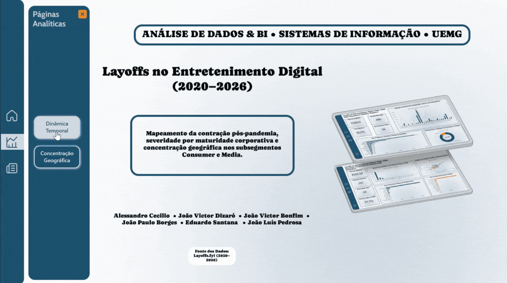](https://app.powerbi.com/view?r=eyJrIjoiMGFjNjhhYzItZjk2MC00MzFmLTlkYWQtZTNmZjdlNDcyY2M0IiwidCI6IjU1ZWRkMDA3LTY2ZTItNDllOS1iZWM3LWU1YWIxYzFiYWMyNiJ9)

*Clique na animação para abrir o dashboard interativo.*

</div>

---

## 📌 Sobre o Projeto

Este repositório documenta um **trabalho acadêmico em grupo**, desenvolvido na disciplina de **Análise de Dados** do 6º período do Bacharelado em **Sistemas de Informação** da **Universidade do Estado de Minas Gerais (UEMG) – Unidade Passos**, com a abordagem **PBL (*Problem-Based Learning*)**.

O estudo investiga a **reestruturação e contração da força de trabalho no setor de Entretenimento Digital** — recorte formado pelas categorias `Consumer` e `Media` da base pública *Layoffs.fyi* — e a **compara diretamente com as demais indústrias de tecnologia** (`Other Industries`) presentes na mesma base. O recorte de Entretenimento Digital reúne **486 eventos** e **113.822 desligamentos** entre março de 2020 e novembro de 2026.

> **Problema de negócio.** Como o Entretenimento Digital atravessou o ciclo de demissões pós-pandemia em relação ao restante do mercado de tecnologia, quão concentrado é o impacto (em empresas e em polos geográficos) e o que o estágio de maturidade corporativa e o capital captado indicam sobre a profundidade dos cortes e o risco de encerramento?

### Etapas do PBL

| Etapa | Foco | Onde está no repositório |
|:--:|---|---|
| 1 | Definição do problema e das perguntas de negócio | Seção [Perguntas de Negócio](#-perguntas-de-negócio) |
| 2 | Coleta, descrição e delimitação dos dados | `data/raw/layoffs.csv`, seção [Dados e Engenharia de Atributos](#-dados-e-engenharia-de-atributos) |
| 3 | Qualidade e preparação dos dados | `notebooks/01_data_cleaning.ipynb`, `src/utils/`, `docs/figures/cleaning/` |
| 4 | Análise exploratória (EDA) | `notebooks/02_eda_analysis.ipynb`, `sql/`, `docs/figures/eda/` |
| 5–6 | Inferência estatística e investigação de relações | `notebooks/02_eda_analysis.ipynb` (seções 2, 4 e 5) |
| 6 | Visualização e apoio à decisão | `dashboard/`, `docs/figures/dashboard_figures/`, `docs/gifs/dashboard_gifs/` |
| 7–8 | Interpretação, limitações e recomendações | Seções [Conclusões](#-conclusões-gerais) e [Limitações](#️-limitações) |

---

## 🧭 Sumário

1. [Perguntas de Negócio](#-perguntas-de-negócio)
2. [Fluxo do Projeto](#-fluxo-do-projeto)
3. [Dados e Engenharia de Atributos](#-dados-e-engenharia-de-atributos)
4. [Tecnologias Utilizadas](#-tecnologias-utilizadas)
5. [Estrutura do Repositório](#-estrutura-do-repositório)
6. [Processo Analítico](#-processo-analítico)
7. [Principais Resultados](#-principais-resultados)
8. [Dashboard Interativo (Power BI + Figma)](#-dashboard-interativo-power-bi--figma)
9. [Conclusões Gerais](#-conclusões-gerais)
10. [Recomendações Estratégicas](#-recomendações-estratégicas)
11. [Limitações](#️-limitações)
12. [Trabalhos Futuros](#-trabalhos-futuros)
13. [Como Executar Localmente](#-como-executar-localmente)
14. [Equipe / Autores](#-equipe--autores)

---

## ❓ Perguntas de Negócio

| # | Pergunta | Eixo | Evidência principal |
|:--:|---|---|---|
| 1 | Quando ocorreram os maiores picos de desligamento e como o Entretenimento Digital se comportou frente ao restante do mercado de tecnologia? | Ciclos temporais | `vw_evolucao_temporal`, figuras `03`, `04`, `05` |
| 2 | Há diferença estatística no **volume** e na **severidade percentual** dos cortes entre `Consumer` e `Media`? | Subsegmentos | Mann-Whitney U, figura `06` |
| 3 | O estágio corporativo (de `Seed` a `Post-IPO`) influencia a profundidade dos cortes e o risco de encerramento? | Maturidade | ANOVA, Kruskal-Wallis, figura `07` |
| 4 | O capital captado se relaciona com o volume e com o percentual de corte? | Capital | Spearman, figura `08` |
| 5 | Qual o grau de concentração dos desligamentos por **empresa**? | Concentração corporativa | Pareto / Lorenz, figura `09` |
| 6 | Qual o grau de concentração por **país** e por **polo urbano**? | Concentração geográfica | `vw_analise_geografica`, figura `10` |

---

## 🔄 Fluxo do Projeto

```text
┌──────────────────┐   ┌─────────────────────────────────────┐   ┌────────────────────────┐
│    CSV RAW       │   │  PYTHON (Pandas · SciPy · Seaborn)  │   │  POSTGRESQL            │
│ data/raw/        │──▶│  01_data_cleaning.ipynb             │──▶│  tabela `layoffs`      │
│ layoffs.csv      │   │  • auditoria · deduplicação         │   │  sql/01 … sql/03       │
│ (4.675 × 11)     │   │  • padronização · outliers          │   │  sql/04_create_views   │
└──────────────────┘   │  • features (sector_scope, ...)     │   │  5 views analíticas    │
                       │  02_eda_analysis.ipynb              │   └───────────┬────────────┘
                       │  • EDA · normalidade · testes       │               │
                       │  → data/processed/layoffs_clean.csv │               ▼
                       │    (4.655 × 19)                     │   ┌────────────────────────┐
                       └─────────────────────────────────────┘   │  EXCEL / CSV           │
                                                                 │  docs/tables/{csv,     │
                                                                 │  excel,txt}            │
                                                                 │  scripts/export_sql_   │
                                                                 │  report.py             │
                                                                 └───────────┬────────────┘
                                                                             │
                       ┌─────────────────────────────────────┐               │
                       │  FIGMA + POWER BI                   │◀──────────────┘
                       │  fundos/layout (Figma) + modelo     │
                       │  dashboard/*.pbix → Power BI Web    │
                       └─────────────────────────────────────┘
```

---

## 🗃️ Dados e Engenharia de Atributos

### Fonte

**Layoffs.fyi** — base pública que consolida anúncios de demissões em empresas de tecnologia a partir de notícias e comunicados. Cada linha representa **um evento de desligamento** (unidade de análise). A extração utilizada (`data/raw/layoffs.csv`) contém **4.675 registros e 11 colunas**, com eventos de **11/03/2020 a 11/11/2026**.

| Variável | Tipo | Papel analítico |
|---|---|---|
| `company` | texto | Identificação da empresa (agregação de Pareto) |
| `location` | texto | Polo urbano do corte |
| `country` | texto | Agregação geográfica |
| `industry` | categórica | Define o recorte (`Consumer`, `Media` e outras 28 categorias) |
| `stage` | categórica | Maturidade corporativa (16 níveis, de `Seed` a `Post-IPO`) |
| `total_laid_off` | inteiro anulável | Volume absoluto de desligados |
| `percentage_laid_off` | decimal (0–1) | Severidade relativa do corte |
| `funds_raised` | decimal (US$ milhões) | Capital captado |
| `date` / `date_added` | data | Data do evento e da catalogação |
| `source` | texto | Fonte jornalística do registro |

### Critério de recorte (`sector_scope`)

```python
entertainment_sectors = ['Consumer', 'Media']
df_clean['sector_scope'] = np.where(
    df_clean['industry'].isin(entertainment_sectors),
    'Digital Entertainment',
    'Other Industries'
)
```

| `sector_scope` | Eventos | Desligados | Papel |
|---|--:|--:|---|
| `Digital Entertainment` (`Consumer` + `Media`) | 486 (322 + 164) | 113.822 | Objeto do estudo |
| `Other Industries` | 4.169 | 831.014 | Grupo de *benchmark* de mercado |
| **Total (base limpa)** | **4.655** | **944.836** | — |

### Tratamento (resumo)

| Etapa | Regra aplicada | Resultado |
|---|---|---|
| Classificação setorial | Remoção dos 2 registros com `industry` nulo (*Eyeo* e *Appsmith*) | 4.673 registros (99,96% da base) |
| Duplicidades | Chave composta `(company, location, date)`, priorizando completude e maior `total_laid_off` | 21 grupos auditados: 5 mantidos (cidades distintas), 4 exatos removidos, 12 consolidados → **4.655** registros |
| `funds_raised` | Propagação **apenas** entre registros com mesma `company`, `country` e `stage` conhecido | 5 valores recuperados; demais preservados como `NaN` |
| `country` / `location` / `stage` / `source` | Mapeamento unívoco (Berlin→Germany, Montreal→Canada); `'Unknown'` para nulos pontuais | 0 nulos nessas colunas |
| Padronização | `UAE`→`United Arab Emirates`; remoção do sufixo `, Non-U.S.`; correção cidade×país (16 registros); 11 pares de empresas por capitalização | 66 países, 260 localidades, 2.998 empresas |
| Domínio | `percentage_laid_off = 0` (TaskUs) → `NaN`; 36 `reporting_lag_days` negativos → `NaN` | Datas de evento preservadas |
| *Outliers* | **Mantidos** (reestruturações reais), sinalizados por flags | Ver abaixo |

### Atributos derivados

| Atributo | Definição |
|---|---|
| `sector_scope` | `Digital Entertainment` ou `Other Industries` |
| `year`, `quarter`, `year_month` | Granularidades temporais a partir de `date` |
| `reporting_lag_days` | `date_added − date` (em dias) |
| `metric_completeness` | `Complete (Both Metrics)`, `Headcount Only`, `Percentage Only`, `Event Record Only` |
| `is_company_shutdown` | `percentage_laid_off == 1.0` (encerramento total) |
| `layoff_scale` | `Small (1–50)`, `Medium (51–200)`, `Large (201–440)`, `Massive Outlier (>440)`, `Not Reported` |

### Tratamento da assimetria

Os valores extremos **não foram excluídos**. O método do IQR (cerca superior de **440** pessoas) sinalizou **361 eventos (11,90%)** em `total_laid_off`, que representam reestruturações reais de grandes corporações (até 22.000 na Intel e 21.000 na Oracle). Excluí-los subestimaria o volume do setor. A assimetria foi tratada com **estatísticas robustas** (mediana e IQR), **testes não paramétricos** e **escalas logarítmicas** nas visualizações.

| Variável (base limpa, N válido) | Média | Desvio padrão | Mediana | IQR | Assimetria | Curtose |
|---|--:|--:|--:|--:|--:|--:|
| `total_laid_off` (3.034) | 311,42 | 1.109,40 | 90,00 | 160,00 | 10,75 | 148,72 |
| `percentage_laid_off` (2.903) | 0,30 | 0,31 | 0,17 | 0,23 | 1,50 | 0,83 |
| `funds_raised` (4.107) | 969,01 | 5.581,97 | 176,00 | 434,00 | 17,97 | 375,15 |
| `reporting_lag_days` (4.619) | 11,78 | 56,76 | 1,00 | 3,00 | 11,90 | 187,91 |

> ℹ️ **Convenção de escopo.** Itens marcados com **†** foram **recalculados a partir de `data/processed/layoffs_clean.csv`** (mesma base e mesmos métodos do notebook) para segmentar por `sector_scope`, e não constam como output dos notebooks. Os demais valores vêm diretamente dos notebooks (`01_data_cleaning.ipynb`, `02_eda_analysis.ipynb`) ou de `docs/tables/txt/todos_resultados_sql.txt`.

---

## 🛠️ Tecnologias Utilizadas

| Camada | Ferramenta | Uso no projeto |
|---|---|---|
| Linguagem | **Python 3.13** | Limpeza, EDA e inferência |
| Dados | **Pandas**, **NumPy** | Manipulação, tipagem e engenharia de atributos |
| Estatística | **SciPy**, **Statsmodels** | Shapiro-Wilk, D'Agostino K², Mann-Whitney, Welch, ANOVA, Kruskal-Wallis, Tukey HSD, Spearman |
| Visualização | **Matplotlib**, **Seaborn** | Figuras de qualidade e de EDA (300 dpi) |
| Banco de dados | **PostgreSQL** + **SQLAlchemy** + **psycopg2** | Tabela tipada, carga via `COPY`, 5 views analíticas |
| Exportação | **openpyxl** | Relatório Excel das consultas SQL |
| Notebooks | **Jupyter / IPython** | `01_data_cleaning` e `02_eda_analysis` |
| Design | **Figma** | Layout, fundos, navegação e painel de filtros |
| BI | **Power BI** (Desktop e Web) | Dashboard de 4 páginas |
| Configuração | **python-dotenv** | Credenciais do banco via `.env` |

---

## 📁 Estrutura do Repositório

```text
digital_entertainment_layoffs/
├── dashboard/
│   ├── digital_entertainment_layoffs.pbix        # Modelo Power BI (4 páginas)
│   └── Esqueleto/                                # Ativos de design (Figma)
│       ├── Fundos/
│       │   ├── Padrão/                           # Fundos base: Home, Dinâmica Temporal,
│       │   │                                     #   Concentração Geográfica, Sobre o Case
│       │   ├── Filtros/                          # Fundos com painel de filtros
│       │   └── Navegação/                        # Fundos com barra de navegação
│       ├── Ilustracao_dashbords.png
│       └── Gemini_Generated_Image_*.png / .jpg
├── data/
│   ├── raw/layoffs.csv                           # Base bruta (4.675 × 11)
│   └── processed/layoffs_clean.csv               # Base tratada (4.655 × 19)
├── docs/
│   ├── figures/
│   │   ├── cleaning/                             # 9 figuras da auditoria de qualidade
│   │   ├── dashboard_figures/                    # 4 capturas das páginas do dashboard
│   │   └── eda/                                  # 10 figuras da análise exploratória
│   ├── gifs/
│   │   └── dashboard_gifs/                       # demo_comparativo_setorial.gif
│   │                                             # demo_subsegmentos.gif
│   │                                             # demo_estrutura_geo.gif
│   └── tables/
│       ├── csv/                                  # Views e resumos exportados (7 CSVs)
│       ├── excel/digital_entertainment_layoffs_analise_sql.xlsx
│       └── txt/todos_resultados_sql.txt          # Saída bruta das consultas SQL
├── notebooks/
│   ├── 01_data_cleaning.ipynb
│   └── 02_eda_analysis.ipynb
├── scripts/
│   └── export_sql_report.py                      # PostgreSQL/TXT → CSV e Excel
├── sql/
│   ├── 01_temporal_trends.sql
│   ├── 02_severity_and_stages.sql
│   ├── 03_top_companies_geo.sql
│   └── 04_create_views.sql                       # 5 views consumidas por Python e Power BI
├── src/
│   ├── io/            # data_load.py · data_save.py (carga via COPY no PostgreSQL)
│   ├── plots/         # visualizations.py · outliers_plot.py
│   └── utils/         # data_quality.py · outliers.py
├── .gitignore
├── requirements.txt
└── README.md
```

**Views analíticas** (`sql/04_create_views.sql`, filtradas por `sector_scope = 'Digital Entertainment'`): `vw_evolucao_temporal`, `vw_comparacao_subsegmentos`, `vw_analise_geografica`, `vw_perfil_estagio_empresas` e `vw_top15_empresas`.

---

## 🔬 Processo Analítico

| Fase | Entradas | Procedimentos | Saídas |
|---|---|---|---|
| **1. Auditoria e limpeza** | `layoffs.csv` | Qualidade (nulos, duplicidades, domínio), deduplicação, padronização geográfica e categórica, diagnóstico de *outliers* por IQR | `layoffs_clean.csv`, figuras de `cleaning/` |
| **2. Modelagem SQL** | `layoffs_clean.csv` | Carga tipada no PostgreSQL (`COPY`), consultas temáticas e criação de views | Tabelas em `docs/tables/` |
| **3. EDA e inferência** | Tabela `layoffs` e views (fallback para CSV) | Estatística descritiva robusta, normalidade, comparação de grupos, correlação de postos, Pareto/Lorenz | Figuras `01`–`10` |
| **4. Visualização** | Views / CSVs | Layout no Figma, modelo e medidas no Power BI | `.pbix`, capturas e GIFs |

### Qualidade dos dados (base limpa)

| Indicador | Qtd. | % |
|---|--:|--:|
| `percentage_laid_off` nulo | 1.752 | 37,64 |
| `total_laid_off` nulo | 1.621 | 34,82 |
| `funds_raised` nulo | 548 | 11,77 |
| `reporting_lag_days` nulo (defasagens negativas anuladas) | 36 | 0,77 |
| Duplicidade parcial restante (mesma empresa e data, cidades distintas) | 5 | 0,11 |

Os nulos em `total_laid_off` e `percentage_laid_off` são **estruturais** (ex.: startups em `Seed` reportam sobretudo o percentual; empresas `Post-IPO`, sobretudo o número absoluto) e foram **preservados como `NaN`**, sem imputação.

| Completude das métricas (Entretenimento Digital) | Eventos | % |
|---|--:|--:|
| `Complete (Both Metrics)` | 198 | 40,74 |
| `Headcount Only` | 126 | 25,93 |
| `Event Record Only` | 86 | 17,70 |
| `Percentage Only` | 76 | 15,64 |

<p align="center">
  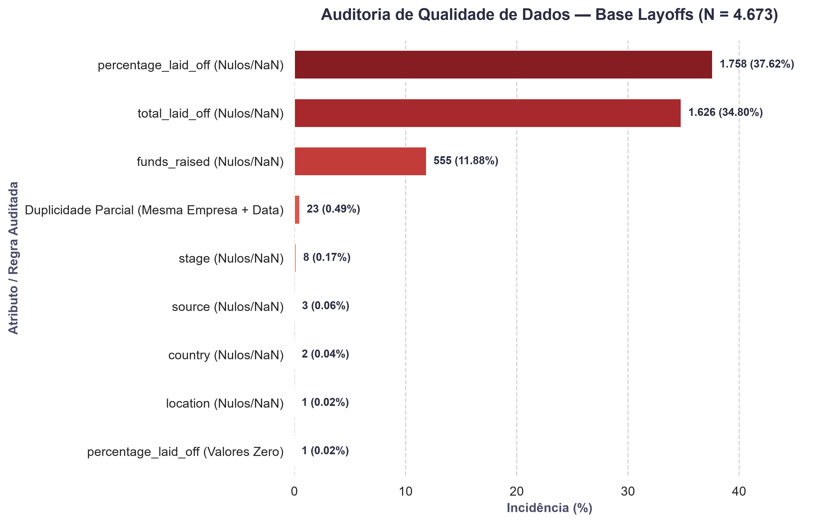
  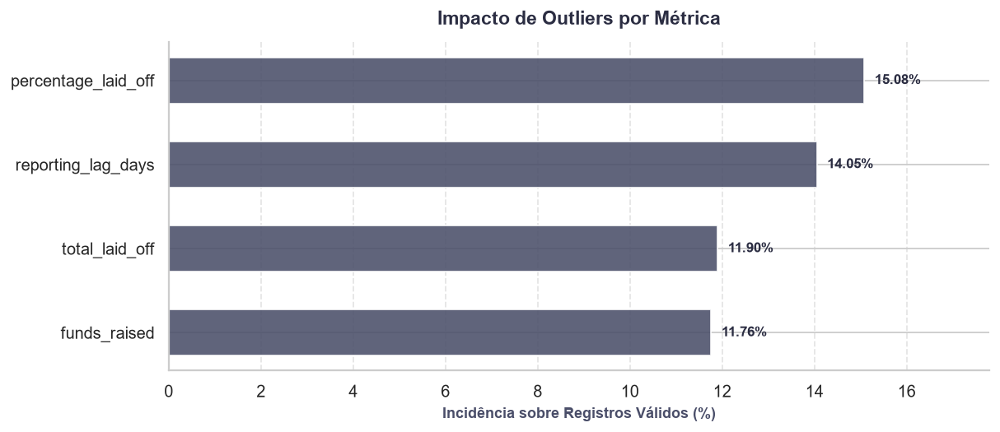
</p>

---

## 📊 Principais Resultados

### 1. Assimetria distributiva e escolha da medida central

Os testes de **Shapiro-Wilk** e **D'Agostino K²** rejeitaram a normalidade em **todas** as variáveis quantitativas (*p* < 0,05). Por isso, a **mediana** e o **IQR** são as medidas adotadas.

| Variável | N | Shapiro-Wilk (W) | *p* | D'Agostino (K²) | *p* |
|---|--:|--:|--:|--:|--:|
| `total_laid_off` | 3.034 | 0,2211 | 1,5·10⁻⁷⁷ | 4.950,92 | < 10⁻³⁰⁰ |
| `percentage_laid_off` | 2.903 | 0,7273 | 2,6·10⁻⁵⁶ | 652,26 | 2,3·10⁻¹⁴² |
| `funds_raised` | 4.107 | 0,1197 | 9,9·10⁻⁸⁸ | 8.592,08 | < 10⁻³⁰⁰ |
| `reporting_lag_days` | 4.619 | 0,1832 | 4,6·10⁻⁸⁹ | 7.925,25 | < 10⁻³⁰⁰ |

> **Nota †.** O notebook executa esses testes sobre a base inteira. Restritos ao Entretenimento Digital, o resultado é idêntico: `total_laid_off` (n = 324; W = 0,2425; K² = 482,98), `percentage_laid_off` (n = 274; W = 0,7076; K² = 73,37) e `funds_raised` (n = 404; W = 0,2162; K² = 525,21), todos com *p* < 0,001.

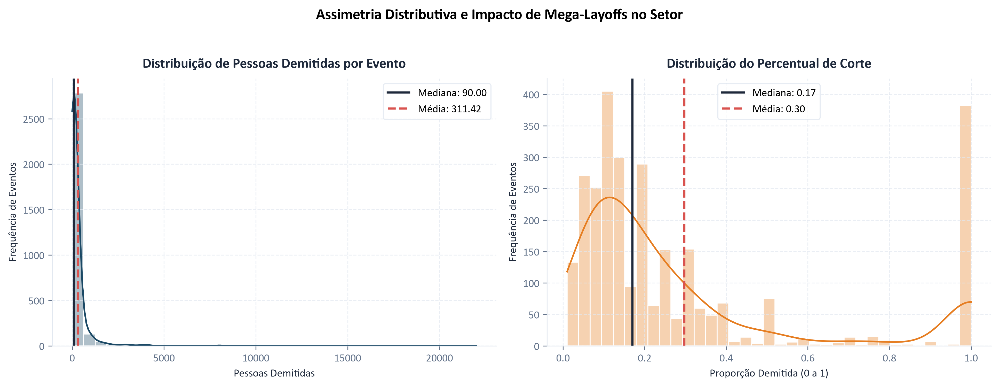

### 2. Ciclos temporais

| Ano | Eventos | Consumer | Media | **Total de desligados** | Variação anual |
|--:|--:|--:|--:|--:|--:|
| 2020 | 60 | 6.063 | 1.131 | **7.194** | — |
| 2021 | 9 | 3.600 | 83 | **3.683** | −48,80% |
| 2022 | 99 | 19.856 | 1.879 | **21.735** | +490,14% |
| 2023 | 128 | 30.403 | 5.641 | **36.044** | +65,83% |
| 2024 | 80 | 11.224 | 1.960 | **13.184** | −63,42% |
| 2025 | 51 | 9.764 | 595 | **10.359** | −21,43% |
| 2026* | 59 | 19.715 | 1.908 | **21.623** | +108,74% |

<sub>*2026 contempla dados até novembro.</sub>

**Trimestres mais críticos:** 2023-Q1 (**29.242** desligados, 58 eventos), 2022-Q4 (17.244), 2026-Q2 (10.759), 2024-Q1 (7.103) e 2026-Q1 (6.375).

| Indicador temporal | Entretenimento Digital | Outras Indústrias |
|---|--:|--:|
| Correlação de Spearman entre as séries trimestrais (28 trimestres) † | ρ = 0,752 (*p* = 3,9·10⁻⁶) | |
| Coeficiente de variação da série trimestral † | **151,10%** | 94,29% |
| Variação do volume em 2022 † | +490,1% | +1.071,9% |
| Variação do volume em 2024 † | −63,4% | −38,8% |
| Variação do volume em 2026 † | **+108,7%** | +9,4% |
| Participação do Entretenimento Digital nos desligamentos globais em 2022-Q4 / 2023-Q1 / 2026-Q2 † | 20,4% / 17,4% / 19,2% | |

> **Leitura.** As duas séries compartilham o **mesmo calendário macroeconômico** (ρ = 0,752), com pico agudo em 2023-Q1 e ondas secundárias em 2024-Q1 e 2026-Q2. O Entretenimento Digital apresenta **maior amplitude de oscilação** (CV de 151,10% contra 94,29%) e quedas e recuperações mais acentuadas em 2024 e 2026, embora em 2022 a expansão relativa das demais indústrias tenha sido maior. A atribuição dessa maior elasticidade à retração do consumo digital pós-isolamento é uma **hipótese interpretativa**, não testada diretamente pelos dados.

| Participação do Entretenimento Digital no total global | 2020 | 2021 | 2022 | 2023 | 2024 | 2025 | 2026 |
|---|--:|--:|--:|--:|--:|--:|--:|
| Eventos (%) † | 9,46 | 20,45 | 8,11 | 9,25 | 12,62 | 15,41 | 14,50 |
| Desligados (%) † | 8,88 | 23,28 | 13,25 | 13,63 | 8,62 | 8,46 | 15,00 |

<p align="center">
  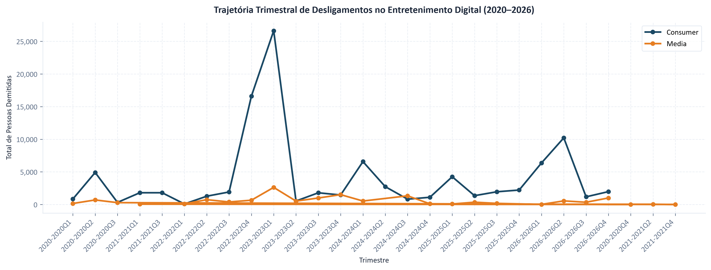
</p>
<p align="center">
  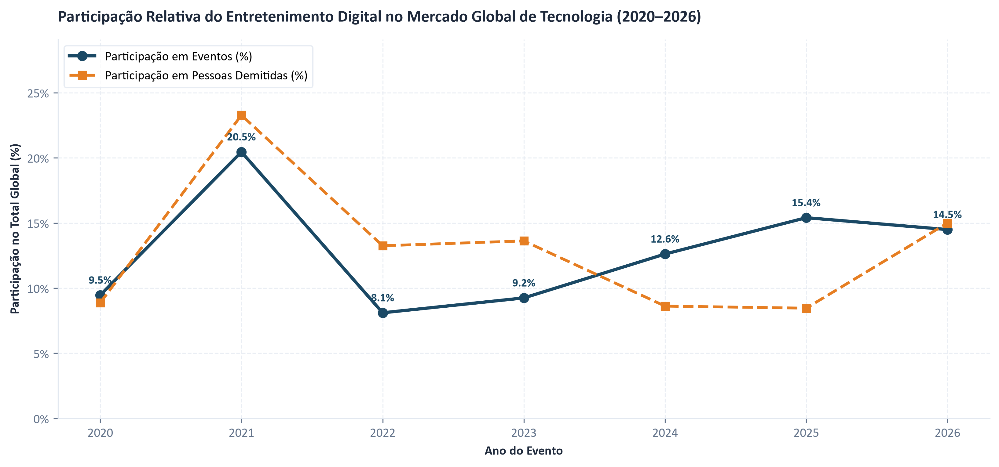
</p>

### 3. Subsegmentos: `Consumer` vs. `Media`

`Consumer` responde por **88,41%** do volume (100.625 desligados, 322 eventos, 177 empresas) e `Media` por **11,59%** (13.197 desligados, 164 eventos, 106 empresas).

| Métrica | Mediana `Consumer` | Mediana `Media` | Mann-Whitney U | *p* | Welch *t* | *p* (Welch) | Diferença (α = 0,05) |
|---|--:|--:|--:|--:|--:|--:|:--:|
| Desligados por evento (213 vs. 111) | 130,0 | 51,0 | 16.462,5 | **6,6·10⁻⁹** | 3,50 | 5,6·10⁻⁴ | ✅ Sim |
| Percentual de corte (170 vs. 104) | 17% | 15% | 9.332,5 | 0,4385 | 0,88 | 0,381 | ❌ Não |
| Capital captado, US$ mi (270 vs. 134) | 187,5 | 129,0 | 19.509,0 | 0,1992 | −1,91 | 0,059 | ❌ Não |

> `Consumer` realiza eventos **significativamente maiores em volume absoluto**, mas ambos os subsegmentos aplicam **proporções medianas semelhantes** de corte por rodada. O **corte mediano do setor é de 16,0%**.

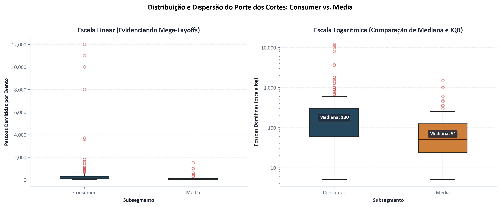

### 4. Entretenimento Digital vs. Outras Indústrias †

| Métrica | Mediana Ent. Digital | Mediana Outras | Mann-Whitney U | *p* | Correlação bisserial por postos |
|---|--:|--:|--:|--:|--:|
| Desligados por evento (324 vs. 2.710) | 91,5 | 90,0 | 449.789,5 | 0,4698 | −0,025 |
| Percentual de corte (274 vs. 2.629) | 16% | 18% | 352.298,0 | 0,5501 | 0,022 |
| Capital captado, US$ mi (404 vs. 3.703) | 158,5 | 180,0 | 718.656,5 | 0,1947 | 0,039 |

> **Leitura.** No nível do **evento**, o Entretenimento Digital **não se distingue** estatisticamente das demais indústrias em porte, severidade ou capitalização típicos. As diferenças relevantes aparecem na **estrutura** (concentração em poucas empresas e em um polo geográfico) e na **amplitude temporal** dos ciclos, não na dimensão do corte típico.

### 5. Estágio corporativo e severidade

| Variável | Estágios (n ≥ 8) | ANOVA (*F*) | *p* | Kruskal-Wallis (*H*) | *p* |
|---|--:|--:|--:|--:|--:|
| Percentual de corte (N = 2.439) | 14 | 84,70 | 4,0·10⁻¹⁸⁶ | 629,84 | 3,3·10⁻¹²⁶ |
| Volume de desligados | 14 | 10,31 | 2,6·10⁻²¹ | 557,33 | 9,4·10⁻¹¹¹ |

Comparações pareadas † (91 pares): **42** significativos por Mann-Whitney com correção de Bonferroni e **40** por Tukey HSD.

**Perfil dos estágios no Entretenimento Digital** (`vw_perfil_estagio_empresas`):

| Estágio | Eventos | Empresas | Desligados | Corte mediano | Encerramentos |
|---|--:|--:|--:|--:|--:|
| `Post-IPO` | 145 | 49 | 75.056 | **10,5%** | 0 |
| `Unknown` | 92 | 68 | 16.109 | 20,0% | 9 |
| `Acquired` | 87 | 60 | 9.893 | 14,0% | 6 |
| `Series B` | 32 | 23 | 1.736 | 30,0% | 2 |
| `Seed` | 18 | 18 | 725 | **100,0%** | 9 |
| `Series C` | 29 | 19 | 618 | 18,5% | 3 |
| `Series A` | 12 | 12 | 184 | **90,0%** | 4 |

> **Leitura.** `Post-IPO` lidera o volume absoluto (**66%** dos desligados do setor †) com cortes medianos baixos (ajuste de margem), enquanto `Seed` e `Series A` sofrem cortes quase totais. Dos **36 encerramentos** mapeados, 9 são de `Seed` e 4 de `Series A`.
> Restrito ao Entretenimento Digital †, o efeito do estágio se mantém (9 estágios com n ≥ 8: Kruskal-Wallis *H* = 65,86, *p* = 3,3·10⁻¹¹; ANOVA *F* = 16,96, *p* = 4,4·10⁻¹⁹).

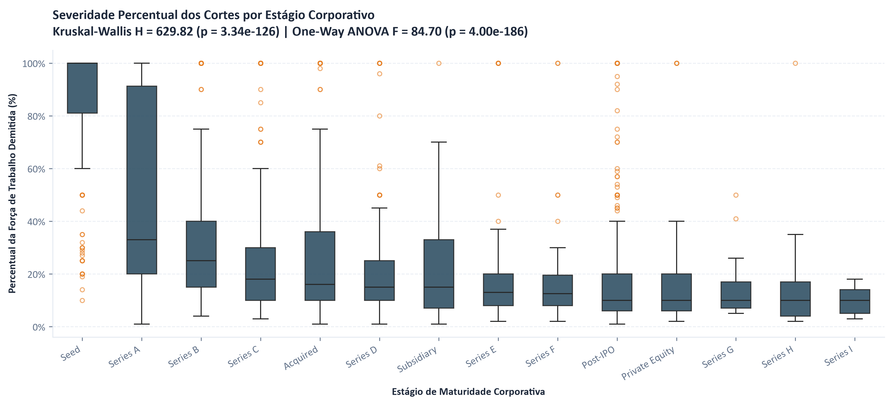

<sub>A figura `07` é calculada sobre a base inteira (14 estágios); a tabela acima traz o recorte de Entretenimento Digital.</sub>

**Encerramentos** † — Entretenimento Digital: 36 de 486 eventos (**7,41%**); Outras Indústrias: 345 de 4.169 (**8,28%**); teste qui-quadrado, χ² = 0,33, *p* = 0,567. **Não há evidência de que o Entretenimento Digital tenha taxa de encerramento diferente** das demais indústrias.

### 6. Capital captado

| Relação (Spearman) | Base inteira (N pareado) | ρ | *p* | Ent. Digital † (N pareado) | ρ | *p* |
|---|--:|--:|--:|--:|--:|--:|
| Capital × Total demitidos | 2.711 | **+0,41** | 4,7·10⁻¹⁰⁸ | 272 | +0,39 | 3,8·10⁻¹¹ |
| Capital × Percentual de corte | 2.584 | **−0,39** | 9,7·10⁻⁹⁶ | 231 | −0,36 | 2,1·10⁻⁸ |
| Total demitidos × Percentual | 2.041 | −0,05 | 0,030 | 198 | −0,08 | 0,272 |

Quanto maior o capital captado, **maior o volume absoluto** e **menor o percentual** de corte, o que é consistente com o efeito de escala das empresas maduras.

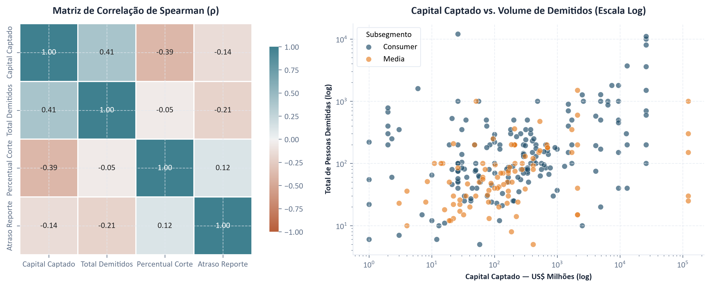

### 7. Concentração corporativa (Pareto e Lorenz)

As **15 empresas** mais afetadas concentram **70,53%** dos desligamentos do Entretenimento Digital, com liderança de **Meta (35.700)** e **Google (13.749)**, que somam **43,44%**.

| # | Empresa | Subsegmento | Rodadas | Desligados | % do setor | % acumulado |
|--:|---|---|--:|--:|--:|--:|
| 1 | Meta | Consumer | 9 | 35.700 | 31,36 | 31,36 |
| 2 | Google | Consumer | 11 | 13.749 | 12,08 | 43,44 |
| 3 | Bytedance | Consumer | 6 | 5.700 | 5,01 | 48,45 |
| 4 | Twitter | Consumer | 3 | 3.940 | 3,46 | 51,91 |
| 5 | Snap | Consumer | 5 | 2.970 | 2,61 | 54,52 |
| 6 | Playtika | Consumer | 6 | 2.440 | 2,14 | 56,67 |
| 7 | Spotify | Media | 6 | 2.370 | 2,08 | 58,75 |
| 8 | Electronic Arts | Consumer | 5 | 2.350 | 2,06 | 60,81 |
| 9 | TikTok | Consumer | 7 | 2.235 | 1,96 | 62,78 |
| 10 | Epic Games | Consumer | 2 | 1.870 | 1,64 | 64,42 |
| 11 | Yahoo | Consumer | 1 | 1.600 | 1,41 | 65,83 |
| 12 | Netflix | Media | 5 | 1.505 | 1,32 | 67,15 |
| 13 | Juul | Consumer | 2 | 1.300 | 1,14 | 68,29 |
| 14 | Canva | Consumer | 2 | 1.281 | 1,13 | 69,42 |
| 15 | Magic Leap | Consumer | 3 | 1.268 | 1,11 | 70,53 |

| Indicador † | Entretenimento Digital | Outras Indústrias |
|---|--:|--:|
| Empresas com headcount reportado | 198 | 1.840 |
| Participação das Top 15 | **70,53%** | 35,83% |
| Participação das Top 2 | **43,44%** | 12,39% |
| Índice de Gini (desligados por empresa) | 0,8213 | 0,8012 |

> **Leitura.** A concentração **no topo** é muito mais intensa no Entretenimento Digital (Top 15 com o dobro da participação relativa). O Gini global é alto nos dois grupos (cauda longa de empresas com poucos cortes), de modo que o contraste está na **cabeça da distribuição**.

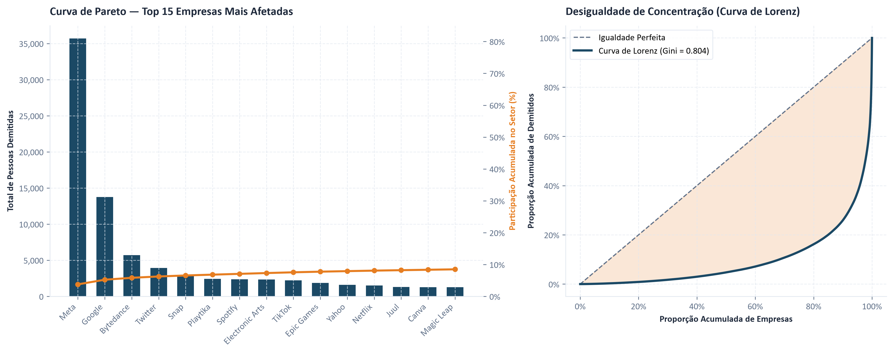

> ⚠️ **Atenção ao regenerar a figura `09`.** Na versão do notebook, a linha de participação acumulada e o Gini (0,804) usam como denominador o total **global** (944.836), e não o do Entretenimento Digital (113.822). A figura corrigida (denominador do escopo; Gini 0,821 contra 0,801 das demais indústrias) deve substituir `docs/figures/eda/09_pareto_lorenz_empresas.png`.

### 8. Concentração geográfica

| País | Eventos | Desligados | % dos desligados | Encerramentos |
|---|--:|--:|--:|--:|
| 🇺🇸 Estados Unidos | 319 | 88.448 | **77,71** | 25 |
| 🇮🇳 Índia | 41 | 8.501 | 7,47 | 6 |
| 🇨🇳 China | 13 | 3.645 | 3,20 | 0 |
| 🇸🇪 Suécia | 18 | 3.570 | 3,14 | 0 |
| 🇮🇱 Israel | 24 | 3.509 | 3,08 | 1 |

| Polo urbano | País | Eventos | Desligados |
|---|---|--:|--:|
| **SF Bay Area** | EUA | 150 | **69.203** |
| Los Angeles | EUA | 28 | 5.589 |
| New York City | EUA | 73 | 4.088 |
| Bengaluru | Índia | 21 | 3.991 |
| Stockholm | Suécia | 18 | 3.570 |

| Indicador † | Entretenimento Digital | Outras Indústrias |
|---|--:|--:|
| Participação dos EUA nos desligados | **77,71%** | 70,00% |
| Participação da SF Bay Area nos desligados | **60,80%** | 29,32% |

> **Leitura.** A **SF Bay Area sozinha** responde por 60,80% dos desligamentos do setor, mais que o dobro do peso do principal polo das demais indústrias (29,32%). Parte desse efeito decorre da sede de Meta e Google na região.

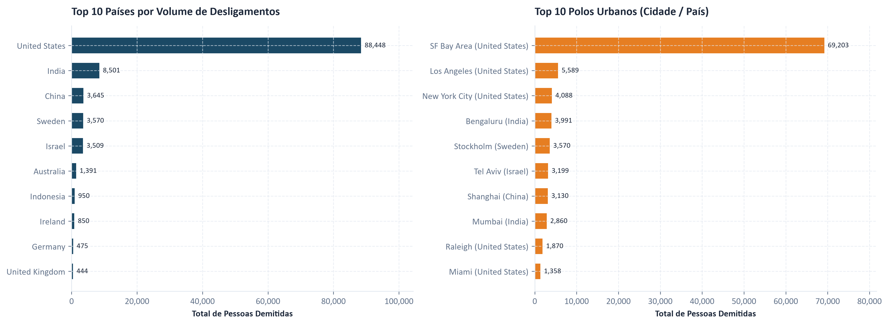

### 9. Porte dos cortes (`layoff_scale`)

| Subsegmento | Escala | Eventos | % no subsegmento | Desligados |
|---|---|--:|--:|--:|
| `Consumer` | `Massive Outlier (>440)` | 41 | 12,73 | 78.530 |
| `Consumer` | `Medium (51–200)` | 95 | 29,50 | 10.852 |
| `Media` | `Small (1–50)` | 55 | 33,54 | 1.401 |
| `Media` | `Massive Outlier (>440)` | 6 | 3,66 | 5.025 |

Em `Consumer`, 41 eventos massivos (12,73%) concentram **78.530** dos 100.625 desligados do subsegmento (78%).

---

## 🖥️ Dashboard Interativo (Power BI + Figma)

O painel foi desenhado no **Figma** (fundos, barra de navegação e painel de filtros, em `dashboard/Esqueleto/`) e implementado no **Power BI** (`dashboard/digital_entertainment_layoffs.pbix`), publicado na Web. Todos os KPIs usam a **mediana** em vez da média, em função da assimetria, e as dispersões usam **escala logarítmica**.

[](https://app.powerbi.com/view?r=eyJrIjoiMGFjNjhhYzItZjk2MC00MzFmLTlkYWQtZTNmZjdlNDcyY2M0IiwidCI6IjU1ZWRkMDA3LTY2ZTItNDllOS1iZWM3LWU1YWIxYzFiYWMyNiJ9)

### Páginas

| # | Página | Conteúdo | Captura |
|:--:|---|---|---|
| 1 | **Home** | Capa do projeto, descrição e barra de navegação |  |
| 2 | **Visão Executiva & Dinâmica Temporal** | KPIs (Total de Demitidos **113.822**, Eventos Mapeados **486**, Corte Mediano **16,0%**, Encerramentos Totais **36**), evolução trimestral combinada (colunas de volume por subsegmento + linha de eventos), Top 15 empresas e participação por subsegmento (Consumer 88,41% / Media 11,59%) |  |
| 3 | **Estrutura Corporativa & Concentração Geográfica** | KPIs (Captação Mediana US$ 158,50 mi, Empresas Afetadas **281**, Países Mapeados **26**, Concentração nos EUA **77,7%**), volume e corte mediano por estágio, dispersão capital × demitidos (escala log), Top 10 países e Top 10 polos |  |
| 4 | **Sobre o Case & Metodologia** | Contexto, perguntas de negócio, pipeline técnico e principais achados |  |

### Filtros

| Filtro | Campo | Páginas | Tipo |
|---|---|:--:|---|
| **Escopo Setorial** (global) | `sector_scope` | 2 e 3 | Caixas de seleção: *Digital Entertainment* / *Other Industries* |
| **Ano** | `year` | 2 e 3 | Intervalo (2020–2026) |
| **Subsegmento** | `industry` | 2 e 3 | Lista suspensa |
| **Tipo de Encerramento** | `is_company_shutdown` | 2 | Falso / Verdadeiro |
| **Empresa** | `company` | 2 | Lista suspensa |
| **Estágio** | `stage` | 3 | Lista suspensa |
| **País** | `country` | 3 | Lista suspensa |

Com o filtro de **Escopo Setorial** limpo, o modelo mostra a base global (944.836 desligados, 4.655 eventos, corte mediano de 17,0% e 381 encerramentos). Com **Digital Entertainment** selecionado, mostra o recorte do estudo, o que permite o **comparativo setorial**. O botão de limpar segmentações restaura a visão original.

### Demonstrações em GIF

**Comparativo setorial** — alternância entre Entretenimento Digital e Outras Indústrias:


**Subsegmentos** — `Consumer` vs. `Media`:

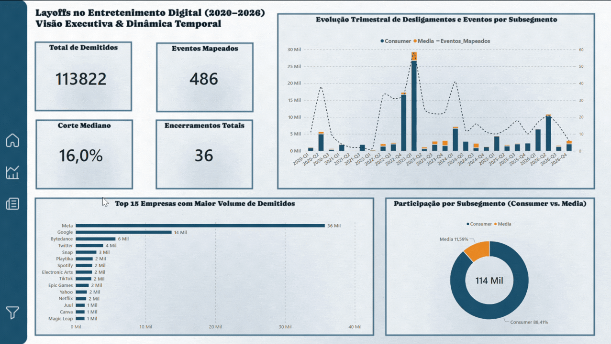

**Estrutura corporativa e geografia** — estágios, capital, países e polos:

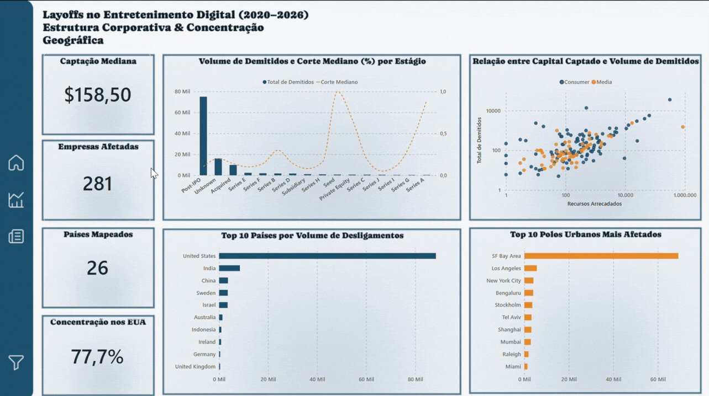

---

## ✅ Conclusões Gerais

1. **Ciclos compartilhados, amplitude maior.** O Entretenimento Digital segue o mesmo calendário das demais indústrias (ρ = 0,752), com pico em **2023-Q1 (29.242 desligados)** e ondas em 2024-Q1 e 2026-Q2, mas com maior amplitude de oscilação (CV de 151,10% contra 94,29%).
2. **Oligopolização do impacto.** **70,53%** dos desligamentos concentram-se nas Top 15 empresas (contra 35,83% nas demais indústrias), lideradas por **Meta (35,7 mil)** e **Google (13,7 mil)**, que somam **43,44%**.
3. **Severidade mediana semelhante.** O **corte mediano é de 16,0%**. `Consumer` (88,41% do volume) faz eventos maiores que `Media` (11,59%) em volume absoluto (*p* = 6,6·10⁻⁹), mas com severidade percentual equivalente (*p* = 0,44). Frente às outras indústrias, o corte típico também não difere (*p* = 0,47 em volume; *p* = 0,55 em severidade).
4. **Maturidade determina a severidade.** `Post-IPO` lidera o volume com corte mediano de **10,5%**; `Seed` (**100%**) e `Series A` (**90%**) enfrentam cortes quase totais, e 13 dos **36 encerramentos** ocorrem nesses dois estágios. A taxa de encerramento do setor (7,41%) **não** difere da das demais indústrias (8,28%; *p* = 0,567).
5. **Polarização geográfica.** Os **EUA concentram 77,71%** dos desligamentos, e a **SF Bay Area** sozinha, 60,80%, seguida por Los Angeles e New York City.

> **Correlação não é causalidade.** Os resultados descrevem padrões e associações em dados públicos; não identificam as causas internas das decisões de cada empresa.

---

## 🎯 Recomendações Estratégicas

| Público | Evidência | Recomendação |
|---|---|---|
| **Startups em estágio inicial** (`Seed`, `Series A`) | Corte mediano de 100% e 90%; 13 dos 36 encerramentos | Planejar *runway* e reserva de caixa, dado que o risco aqui é de continuidade e não de ajuste |
| **Empresas consolidadas** (`Post-IPO`) | Maior volume absoluto, corte mediano de 10,5% | Priorizar ajustes graduais de margem; o impacto reputacional e regional vem do volume, não do percentual |
| **Analistas e gestores de mercado** | Ciclos compartilhados e concentração em poucas empresas | Monitorar poucas empresas-âncora e polos (SF Bay Area) como indicadores antecedentes; usar **mediana** e testes não paramétricos |
| **Profissionais e instituições de ensino** | 77,71% nos EUA | Considerar a dependência de um único polo ao avaliar risco setorial |

---

## ⚠️ Limitações

- **Cobertura da fonte:** *Layoffs.fyi* depende de notícias e comunicados; há **viés de cobertura midiática** (empresas maiores e mais visíveis têm mais registros).
- **Ausência de *headcount* total:** sem o número de funcionários de cada empresa, o percentual de corte só existe quando reportado (**37,64% de nulos**), e o volume absoluto em **34,82%**.
- **Nulos estruturais:** preservados sem imputação; os testes usam apenas casos válidos (N pareado variável).
- **Definição do recorte:** `Consumer` e `Media` são categorias da fonte e funcionam como *proxy* de Entretenimento Digital (incluem, por exemplo, plataformas e redes sociais como Meta e Google).
- **Atributos geográficos:** a coluna `country` reflete o local do corte, e há casos pontuais de sede × operação (por exemplo, Bytedance aparece com país `Indonesia` na tabela Top 15).
- **Escopo de alguns testes:** o notebook executa normalidade, estágio e correlação sobre a base inteira; os recortes por escopo (†) foram recalculados e confirmam os resultados.
- **Causalidade:** não é possível isolar causas internas (IA, margem, ciclo de produto) de cada empresa; a atribuição do ciclo ao consumo digital pós-pandemia é hipótese.
- **2026 parcial:** dados até novembro de 2026.

---

## 🔭 Trabalhos Futuros

- Incorporar o *headcount* total das empresas (fontes como demonstrações financeiras) para calcular severidade independente de relato.
- Modelos explicativos multivariados (por exemplo, regressão com variáveis macroeconômicas e de mercado), mantendo o foco em **inferência**, e não em previsão pontual, dada a natureza exógena dos choques.
- Análise de sobrevivência para o risco de encerramento por estágio.
- Classificação mais granular de Entretenimento Digital (games, streaming, redes sociais, mídia).
- Automatizar a atualização da base e das views.

---

## 💻 Como Executar Localmente

### Pré-requisitos

- **Python 3.13**, **Git**
- **PostgreSQL** instalado e em execução (opcional: o notebook de EDA possui *fallback* para os CSVs)
- **Power BI Desktop** (somente para abrir o `.pbix`)

### 1. Clonar o repositório

```bash
git clone 👉 [INSERIR_LINK_DO_REPOSITORIO_GITHUB_AQUI] 👈
cd digital_entertainment_layoffs
```

### 2. Ambiente virtual e dependências

```bash
# Criar e ativar o ambiente virtual
python -m venv venv

# Windows (PowerShell)
venv\Scripts\Activate.ps1
# Linux / macOS
source venv/bin/activate

# Instalar as dependências
pip install -r requirements.txt
```

### 3. Configurar o PostgreSQL

Crie um arquivo `.env` na raiz do projeto (já ignorado pelo `.gitignore`):

```ini
DB_USER=seu_usuario
DB_PASSWORD=sua_senha
DB_HOST=localhost
DB_PORT=5432
DB_NAME=layoffs
```

> O banco é criado automaticamente na primeira carga, caso não exista.

### 4. Executar o pipeline

```bash
jupyter lab
```

1. Execute `notebooks/01_data_cleaning.ipynb` (gera `data/processed/layoffs_clean.csv` e carrega a tabela `layoffs`).
2. Execute os scripts SQL na ordem, a partir do `psql` ou de um cliente SQL (a última cria as views):

```bash
psql -U seu_usuario -d layoffs -f sql/01_temporal_trends.sql
psql -U seu_usuario -d layoffs -f sql/02_severity_and_stages.sql
psql -U seu_usuario -d layoffs -f sql/03_top_companies_geo.sql
psql -U seu_usuario -d layoffs -f sql/04_create_views.sql
```

3. Execute `notebooks/02_eda_analysis.ipynb` (testes estatísticos e figuras em `docs/figures/eda/`).
4. (Opcional) Exporte as tabelas para CSV e Excel:

```bash
python scripts/export_sql_report.py
```

### 5. Dashboard (Power BI)

1. Abra `dashboard/digital_entertainment_layoffs.pbix` no Power BI Desktop.
2. Se necessário, atualize a fonte de dados (PostgreSQL ou `data/processed/layoffs_clean.csv`) em **Transformar dados → Configurações da fonte de dados**.
3. Ou acesse diretamente a [versão publicada](https://app.powerbi.com/view?r=eyJrIjoiMGFjNjhhYzItZjk2MC00MzFmLTlkYWQtZTNmZjdlNDcyY2M0IiwidCI6IjU1ZWRkMDA3LTY2ZTItNDllOS1iZWM3LWU1YWIxYzFiYWMyNiJ9).

---

## 👥 Equipe / Autores

**Trabalho acadêmico em grupo** — Disciplina de **Análise de Dados** (2026)
Bacharelado em Sistemas de Informação — **Universidade do Estado de Minas Gerais (UEMG) – Unidade Passos**

| # | Integrante |
|:--:|---|
| 1 | Alessandro Moreira Cecilio |
| 2 | Eduardo Santana |
| 3 | João Luís Pedrosa Teles |
| 4 | João Paulo Pimenta |
| 5 | João Victor Bonfim |
| 6 | João Victor Dizaró |

---

<div align="center">

**Fonte dos dados:** [Layoffs.fyi](https://layoffs.fyi) · **Abordagem:** *Problem-Based Learning (PBL)*

*Projeto acadêmico desenvolvido na UEMG – Unidade Passos, 2026.*

</div>
